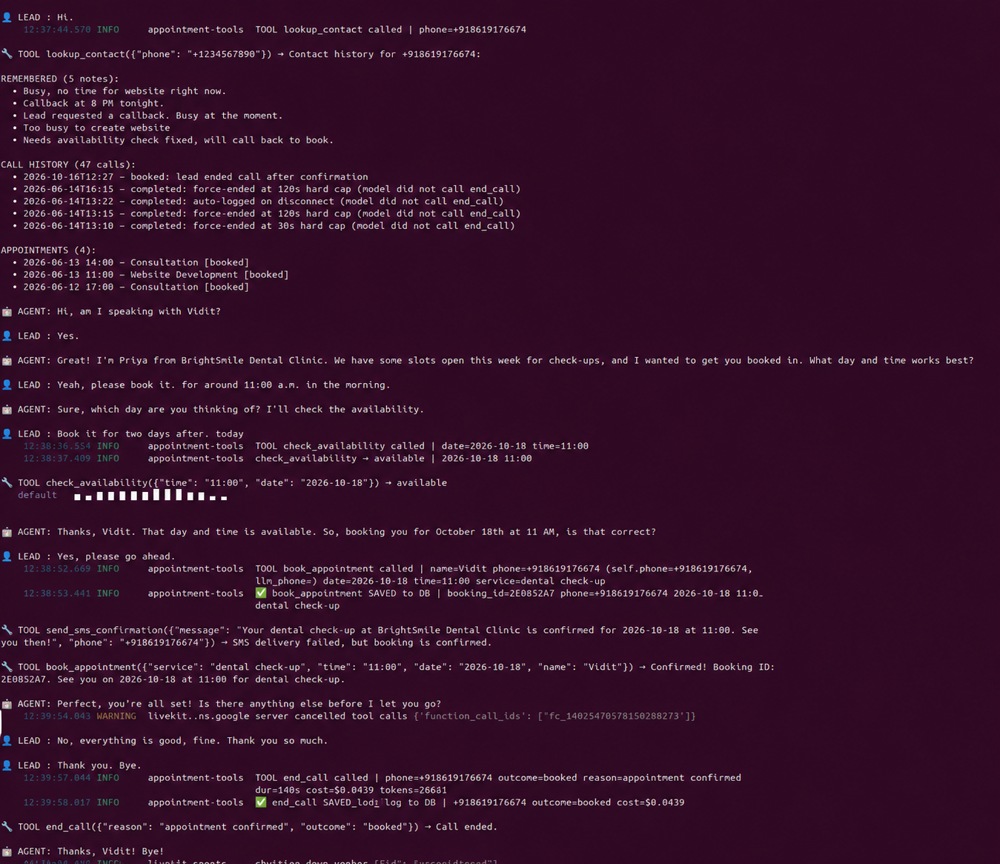

# 🎙️ Console Mode — Test the Agent Without a Phone

Talk to the voice agent through your laptop's mic and speakers. Console mode runs the **same agent, prompt, and tools** as a real phone call, but it skips SIP dialing, so you don't need a carrier, a phone number, or call credit.



*A full session: contact lookup with memory from earlier calls → availability check → booking saved to Supabase → call logged with cost.*

---

## 1. Prerequisites

| Need | Why |
|------|-----|
| Python 3.11+ | Runtime |
| Mic + speakers (headphones recommended) | You are the "lead" |
| [LiveKit Cloud](https://cloud.livekit.io) project | Agent runtime |
| [Gemini API key](https://aistudio.google.com/app/apikey) | The voice model |
| [Supabase](https://supabase.com) project | Bookings, memory, call logs |

You don't need Vobiz, Twilio, Cal.com or Deepgram. Leave those keys blank and the tools will skip them.

## 2. Setup (one time)

```bash
git clone https://github.com/Vidit-lab/AI-Voice-Agent.git
cd AI-Voice-Agent/Cold-Calling-Army
python3 -m venv venv && source venv/bin/activate
pip install -r requirements.txt
cp .env.example .env
```

Run [`supabase_schema.sql`](supabase_schema.sql) in **Supabase → SQL Editor**. Then fill in `.env`:

```ini
LIVEKIT_URL=wss://<project>.livekit.cloud
LIVEKIT_API_KEY=...
LIVEKIT_API_SECRET=...
GOOGLE_API_KEY=...
SUPABASE_URL=https://<ref>.supabase.co
SUPABASE_SERVICE_KEY=...

# Who the agent thinks it is calling (console mode has no call metadata)
DEMO_LEAD_NAME=Vidit
DEMO_BUSINESS_NAME="BrightSmile Dental Clinic"
DEMO_SERVICE_TYPE="dental check-up"
DEMO_PHONE=+919876543210   # used only to key CRM rows; never dialed
```

> Put quotes around values that contain spaces, so that `source .env` works.

Check that the database is reachable:

```bash
python diagnose_db.py
```

## 3. Run

```bash
set -a && source .env && set +a && source venv/bin/activate
python agent.py console --log-level info
```

The agent greets you first. Speak normally; press `Ctrl+C` to quit.

## 4. Test script

| You say | Expect to see |
|---------|---------------|
| "Hi" | `🔧 TOOL lookup_contact` → earlier calls and notes for `DEMO_PHONE` |
| "Yes" (to "am I speaking with Vidit?") | Agent introduces itself as being from `DEMO_BUSINESS_NAME` |
| "Book it for 11 AM, two days from today" | `🔧 TOOL check_availability` → `available` |
| "Yes, go ahead" | `✅ book_appointment SAVED to DB \| booking_id=...` |
| "No, that's all. Bye" | `✅ end_call SAVED call_log to DB ... cost=$...` |

Transcript lines are prefixed `👤 LEAD`, `🤖 AGENT`, and `🔧 TOOL`.

**Verify in Supabase → Table Editor:**
- `appointments`: a new row with the booking ID from the log
- `call_logs`: a new row with `outcome=booked`, duration, and cost
- `contact_memory`: any notes the agent saved

Run the session again. `lookup_contact` now returns the booking you just made, which shows that memory carries over between calls.

## 5. Troubleshooting

| Symptom | Cause / fix |
|---------|-------------|
| `Name or service not known` on DB calls | Supabase project is paused. Restore it in the dashboard. |
| `SMS delivery failed, but booking is confirmed` | Twilio keys are invalid. Blank the `TWILIO_*` keys to skip SMS quietly. |
| Agent uses "our company" or invents names | `DEMO_*` values aren't set or loaded. Re-run `source .env`. |
| `metrics_collected is deprecated` warning | Harmless. |
| No audio | Check the OS default mic/speaker. Use headphones to avoid echo. |

## 6. Next step: a real phone call

Once console mode works, add a SIP trunk (Vobiz values in `.env`, see "Create the SIP trunk" in the [README](README.md)). Then run the worker and dispatch a call:

```bash
python agent.py dev                       # terminal 1
lk dispatch create --new-room --agent-name outbound-caller \
  --metadata '{"phone_number":"+91XXXXXXXXXX","lead_name":"Vidit","business_name":"BrightSmile Dental Clinic","service_type":"dental check-up"}'   # terminal 2
```

The trunk's caller ID must be a number you own on the carrier. If it isn't, calls fail with **403 Forbidden**.
